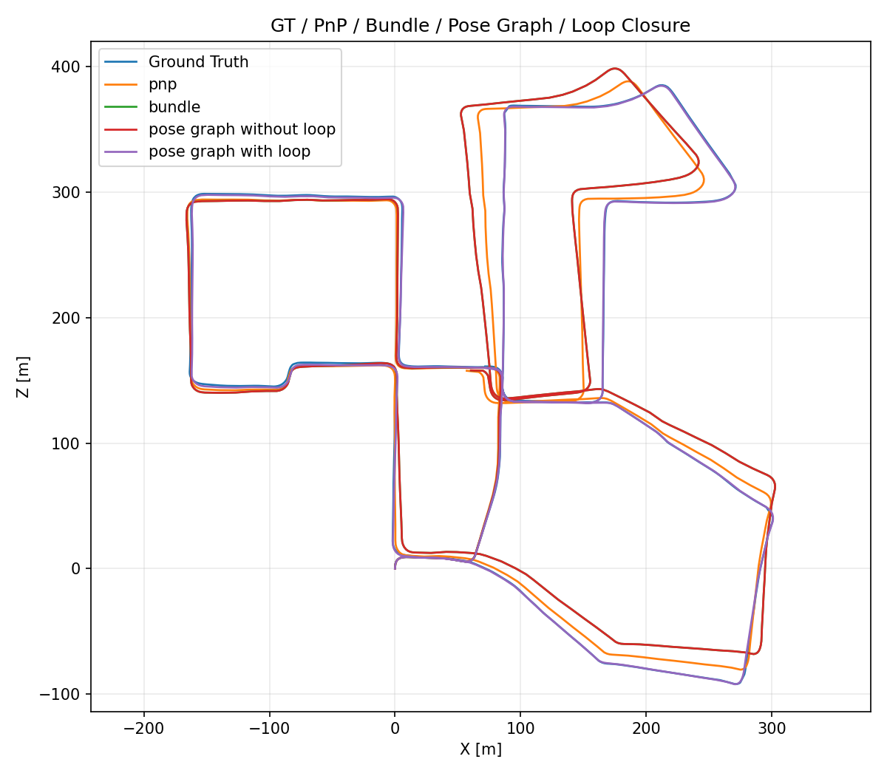

# Vision-Aided Navigation — Stereo Visual SLAM on KITTI

A complete stereo Visual SLAM system: it takes the stereo camera frames of a moving car and reconstructs the car's trajectory, from feature tracking and frame-to-frame Visual Odometry through sliding-window Bundle Adjustment, a global Pose Graph and Loop Closure.

It was developed for the **Vision Aided Navigation** course and then grown into `generic_slam`, a sequence-independent engine with a C++ front end, evaluated on **KITTI Odometry sequence 00**. It uses **OpenCV** for feature-based geometry and **GTSAM** for factor-graph optimization.

## Motivation

Accurate self-localization is a core problem for autonomous vehicles, especially where GPS is unavailable or unreliable: tunnels, urban canyons, indoors. This project shows how far visual data alone can go. Bundle Adjustment and Loop Closure remove most of the drift that frame-to-frame dead reckoning accumulates, so the estimated path stays consistent with the real one over kilometres.

## Results — KITTI 00



Each stage's trajectory against ground truth (blue): raw PnP Visual Odometry (orange), sliding-window Bundle Adjustment (green, under the red line), the Pose Graph before Loop Closure (red), and after Loop Closure (purple), which lies on top of the ground truth.

Absolute trajectory error (RMSE) over the 3,360 frames of sequence 00, for two RANSAC seeds:

| Trajectory | Seed 0 | Seed 1 |
|---|---|---|
| PnP Visual Odometry | 26.8 m | 28.9 m |
| Bundle Adjustment / Pose Graph without loops | 19.0 m | 19.1 m |
| **Pose Graph with Loop Closure** | **1.67 m** | **1.66 m** |

Tracking runs at about 77 ms per frame (~13 Hz) on a 4-core laptop CPU (i7-1165G7), faster than KITTI's 10 Hz camera.

## Pipeline

**Stereo images → stereo matching and triangulation → PnP + RANSAC Visual Odometry → multi-frame tracking database → sliding-window Bundle Adjustment → Pose Graph → Loop Closure → globally optimized trajectory**

- **Feature tracking:** AKAZE features, matched left-to-right inside a row band of the rectified pair, triangulated, and linked across frames into persistent landmark tracks.
- **Visual Odometry:** frame-to-frame pose by PnP (EPnP) inside RANSAC; a hypothesis is scored by reprojection consistency in all four images of two consecutive stereo pairs.
- **Bundle Adjustment:** keyframe-bounded windows; each window jointly optimizes its camera poses and landmarks with GTSAM stereo reprojection factors.
- **Pose Graph:** each window's endpoint relative pose and conditional covariance becomes a `BetweenFactorPose3` between consecutive keyframes.
- **Loop Closure:** candidates are found with a Mahalanobis test on the relative-pose uncertainty, verified by four-view consensus matching and PnP/RANSAC, refined by a two-pose Bundle, and added to the Pose Graph, which is re-optimized.

## Engineering highlights

- **C++ front end, bit-identical to Python.** Feature extraction, stereo matching, temporal matching, triangulation and RANSAC run in a pybind11 module (`native/`) built against a static OpenCV. Its output is identical bit for bit to the reference Python front end — down to re-implementing Python's random number generator and numpy's floating-point evaluation order — so every speed-up can be proven not to change a single result.
- **Resumable, fingerprinted stages.** Every stage (tracking, keyframes, Bundle, Pose Graph, Loop Closure, analysis, report) is saved and fingerprinted by the configuration it depends on. A run resumes from its first unfinished stage, and an experiment reuses every earlier stage its configuration change does not touch.
- **Evidence-based tuning.** Speed-only changes are proven bit-identical with `tools/compare_runs.py`. Changes that alter results are judged on two RANSAC seeds, because the seed alone moves RMSE by ~5–8%. Every experiment, adopted or rejected, is recorded with its numbers in [`configs/experiments/README.md`](configs/experiments/README.md). For example, cutting AKAZE's sublevels from 4 to 2 while lowering its threshold made tracking ~26% faster *and* reduced the loop-closed RMSE from 1.84 m to 1.67 m.

## Repository layout

```text
├── run_slam.py          # entry point for the generic pipeline
├── generic_slam/        # sequence-independent SLAM engine (Python)
├── native/              # C++ front end (generic_slam._native), built by tools/build_native.sh
├── configs/experiments/ # experiment overrides and their recorded results
├── tools/               # build script, run comparison, run status, stage profiler
├── docs/images/         # figures used in this README
└── course_exercises/    # frozen course submission, exercises 1-7 (self-contained)
```

`generic_slam/` is where development happens; it has no dependency on `course_exercises/`. It was also run on KITTI sequence 05.

## Getting started

Requirements: Python 3.8 with the pinned packages in `requirements.txt` (GTSAM 4.2), and the [KITTI Odometry dataset](https://www.cvlibs.net/datasets/kitti/eval_odometry.php) (grayscale images and ground-truth poses). GTSAM's Python wheels make Linux or WSL the easiest platform.

```bash
pip install -r requirements.txt
pip install -e .              # optional: run generic_slam from any directory
bash tools/build_native.sh    # C++ front end (Linux/WSL), see below
python run_slam.py --dataset-root <kitti-root> --sequence 00 --output-root outputs/seq00
```

The C++ front end is the default (`frontend.backend: "native"`). `tools/build_native.sh` needs CMake, pybind11 and a static OpenCV 4.12.0 install (`OPENCV_DIR`, default `~/opt/opencv-4.12.0`). Without the module a run stops at once with a clear message; set `frontend.backend` to `"python"` in a `--config` override to run the pure-Python front end instead (it also supports ORB and SIFT).

Useful options:

- **Resume:** rerun with the same `--output-root` to continue from the first unfinished stage.
- **Run only part:** `--stop-after bundle` (any stage name) stops there.
- **Experiment without recomputing:** `--reuse-from <earlier output root>` with a new `--output-root` and `--config` hard-links every earlier stage whose configuration is unchanged.
- **Watch progress:** `python tools/run_status.py <output-root> --watch 30`.

Readable results (`summary.md`, figures, statistics, resolved config) are copied to `results/<run>_<timestamp>/`.

---

## Course exercises

`course_exercises/` is the frozen course submission. Its files are byte-identical to the submitted versions, so recorded source hashes stay valid. Run its scripts from inside that folder (for example `cd course_exercises && python ex7.py`); it expects `dataset/` and `diagnostics/` inside `course_exercises/`. Detailed reader guides for exercises 4–7 are in `course_exercises/docs/`. On the canonical course run of sequence 00 (3,360 frames, 356 keyframes, 355 Bundle windows) it accepted 6 Loop Closure constraints.

The diagrams below show the main execution and reading flow, not an exhaustive import tree; tests, validators and retained experimental helpers are omitted.

### Exercises 1–2 — Foundations

Feature correspondence, rectified-stereo geometric filtering and 3D triangulation. The original implementations depended on a legacy helper module that was removed during the final cleanup, so `ex1.py` and `ex2.py` are historical placeholders; the runnable pipeline starts with exercise 3.

### Exercise 3 — Stereo Visual Odometry

```text
ex3.py
└── tools.py
    ├── feature detection and stereo matching
    ├── triangulation
    ├── temporal reciprocal matching
    ├── PnP pose estimation
    └── RANSAC / four-view supporter classification
```

Consecutive stereo pairs are connected through feature matching; points triangulated in the previous pair give 3D-to-2D correspondences for PnP. A custom RANSAC scores candidate poses by reprojection consistency in all four images, and the accepted relative poses are accumulated into the initial trajectory. `tools.py` holds the shared geometric primitives, reused by the tracking and loop-closure stages.

### Exercise 4 — Tracking database

```text
ex4.py
└── exercise4_workflow.py
    ├── exercise4_database_builder.py
    │   ├── tracking_database_adapter.py
    │   ├── tracking_database.py
    │   └── tools.py
    └── exercise4_analysis.py
```

Frame-to-frame correspondences become persistent tracks: the database links stereo observations to `TrackId`s and `FrameId`s. `exercise4_database_builder.py` is the sequential pipeline (stereo extraction, temporal matching, four-view consensus, PnP/RANSAC, insertion); `exercise4_analysis.py` produces tracking statistics, reprojection diagnostics and figures.

### Exercise 5 — Sliding-window Bundle Adjustment

```text
ex5.py
├── exercise5_full_run.py
├── exercise5_bundle_window.py
├── exercise5_geometry.py
├── exercise5_artifacts.py
├── exercise5_aggregation.py
├── exercise5_reporting.py
└── exercise5_submission.py
```

The trajectory is split into keyframe-bounded windows. Each window's poses and landmarks are optimized with GTSAM stereo reprojection factors in the frame of its first keyframe (`exercise5_bundle_window.py`); the endpoint relative pose and its conditional covariance are passed to exercise 6. `exercise5_track_survival.py` is kept only for a completed alternative keyframe-policy experiment.

### Exercise 6 — Pose Graph

```text
ex6.py
├── PoseGraph.py
└── exercise6_reporting.py
```

`PoseGraph.py` builds the keyframe graph from the Bundle measurements as `BetweenFactorPose3` constraints, initializes it by composing the relative motions, optimizes it, and computes marginal covariances.

### Exercise 7 — Loop Closure

```text
ex7.py
├── exercise7_sequential_loop_closure.py
│   ├── exercise7_candidate_detection.py
│   ├── exercise7_consensus_matching.py
│   ├── exercise7_small_bundle.py
│   └── exercise7_pose_graph_update.py
└── exercise7_report_freeze.py
```

For each keyframe, earlier keyframes are scored with a Mahalanobis test on the relative covariance along a graph path (`exercise7_candidate_detection.py`), verified geometrically (`exercise7_consensus_matching.py`), and refined with a two-pose Bundle (`exercise7_small_bundle.py`). The resulting factor is added to the Pose Graph, which is re-optimized before processing continues. `exercise7_report_freeze.py` builds report material from sealed results without rerunning anything.

---

## Tech stack

- **Languages:** Python, C++17 (pybind11)
- **Computer vision:** OpenCV — AKAZE (also ORB, SIFT), stereo matching, triangulation, EPnP, RANSAC
- **Optimization:** GTSAM — stereo reprojection factors, Bundle Adjustment, Pose Graph, marginal covariances
- **Numerical computing:** NumPy
- **Dataset:** KITTI Odometry benchmark

The earlier version of this repository (the course code as first published) is kept under the tag `course-version-2025`.
